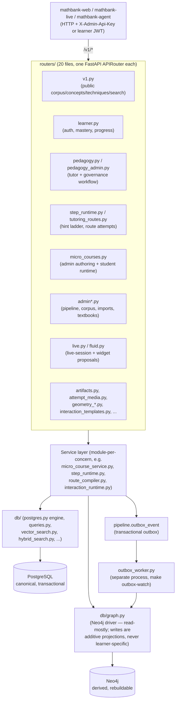
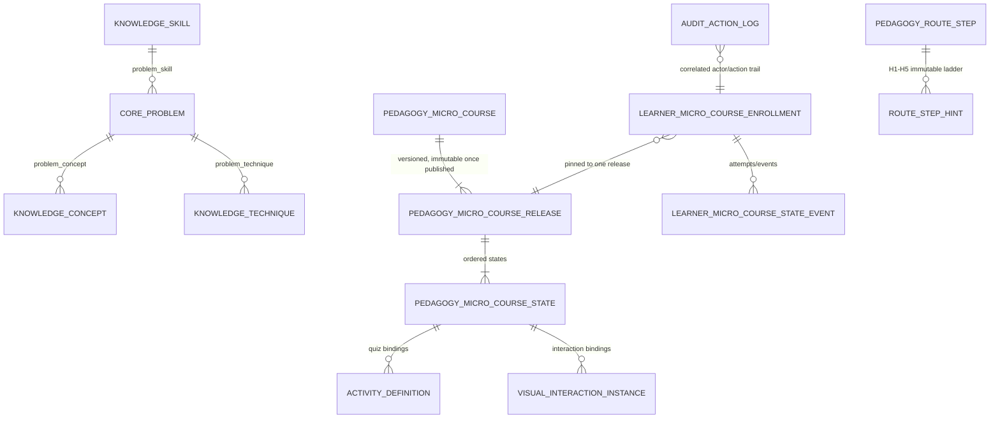

# mathbank-rest

FastAPI service (port `8000`) and the **only** component in this repository that talks to
PostgreSQL (Neon, or a local instance) and Neo4j (AuraDB, or local) directly. Every other
service — `mathbank-web`, `mathbank-live`, `mathbank-agent`, the CLIs in `mathbank-db` and
`mathbank-data-ingestion` — reaches the databases exclusively through this REST API. It owns
hybrid (semantic + lexical + graph) search, learner auth/mastery, the micro-course and
interaction-template runtimes, tutoring-route compilation/serving, and all admin authoring/review/
publication endpoints.

See [documentation/requirements/45_REST_API_DOCUMENTATION_AND_ADMIN_CRUD_GAPS.md](../documentation/requirements/45_REST_API_DOCUMENTATION_AND_ADMIN_CRUD_GAPS.md)
for a grounded audit of this API's current documentation/CRUD completeness, and
[documentation/requirements/reference/REST_API.md](../documentation/requirements/reference/REST_API.md)
for the source-derived endpoint reference.

## Quick start

```bash
cd mathbank-rest
make install      # creates .venv, installs the package + dev deps
make run          # uvicorn --reload on :8000 (foreground)
# or
make start        # background, writes a PID file; make status / make stop / make restart
make test         # pytest; ROUTE_DB_TESTS=1 pytest -q for the live-database tests
```

Configuration is a single `.env` in this folder (`POSTGRES_HOST`/`NEO4J_URI`/`OPENAI_API_KEY`/
`ADMIN_API_KEY`/...). From the repo root, `make sync-openai-key`/`make sync-neon-env` populate it;
see the root [README.md](../README.md) and [documentation/DATABASES.md](../documentation/DATABASES.md).

## Socratic Studio staff authentication

The additive `/v1/admin/socratic` boundary defaults to **verified Cognito staff
sessions**, with an explicit loopback-only local mode for non-AWS development.
It does not accept the legacy shared admin key or learner JWT. Other admin routes are unchanged.
Session authentication, candidate strategies, paginated canonical-source
references and owned draft create/read/update/history/structural-validation
are implemented. Evaluation, proposals and AWS orchestration remain pending.
See the [sequential implementation ledger](../documentation/requirements/67_SOCRATIC_IMPLEMENTATION_HANDOFF.md)
for offline versus live acceptance and the next step.

### Socratic draft schema and persistence

Migration [053](../mathbank-db/sql/053_socratic_drafts.sql) adds four isolated
`orchestration.socratic_*` tables. It does not alter canonical or learner rows.
Draft updates append immutable revisions, audit/outbox evidence and exact
idempotency receipts in one transaction, using expected-hash concurrency
fencing. Sources pin a specific solution revision and optional matching
published route. Strategies are **DRAFT candidates**, not approved curricula.

```sh
cd mathbank-rest
.venv/bin/python scripts/migrate_socratic_drafts.py --direct         # inspection only
.venv/bin/python scripts/migrate_socratic_drafts.py --apply --direct # explicit DDL
SOCRATIC_DB_TESTS=1 .venv/bin/python -m pytest -q tests/test_socratic_postgres.py
# OPTIONAL separate-connection concurrency acceptance: retains ONE synthetic draft
SOCRATIC_DB_TESTS=1 SOCRATIC_CONCURRENCY_TESTS=1 \
  .venv/bin/python -m pytest -q tests/test_socratic_postgres.py -k concurrent
```

These commands use **REST's configured Postgres**, not an automatically
provisioned scratch database. Confirm the intended target first. Normal
database tests roll back their synthetic writes. Concurrency testing alone
commits a labeled `synthetic:socratic-test:*` owner's draft and immutable
evidence; do not delete it by disabling protection triggers.
See the [schema/access catalog](../documentation/requirements/reference/postgres/orchestration.md).
`SOCRATIC_DRAFT_SAVED` outbox events are draft evidence, not publication or a
request for an agent job.

For local password authentication **with real draft storage**, first use
`make setup-socratic-local`, then:

```sh
.venv/bin/python scripts/run_socratic_local.py --with-drafts --port 8000
```

Background equivalent on its own port/pidfile (logs in `.socratic.log`), so it never
collides with the full REST daemon: `make start-socratic-local DRAFTS=1` /
`make stop-socratic-local` / `make status-socratic-local` (default `SOCRATIC_PORT=8019`).
From the repository root, `make socratic-start DRAFTS=1` also starts the Studio UI
proxied to it. Other targets: `make test-socratic`, `make migrate-socratic-drafts`,
`make verify-socratic-deployment URL=...`.

This enables only the isolated API, with loopback binding and proxy headers
disabled; it uses the configured database. Point REST's Postgres settings at
an operator-provided local PostgreSQL with the required migrations for fully
non-AWS/local-database use, or use the explicitly selected Neon target.
The auth-only command remains database-independent by default.
Cloud hosting uses the separate `MathBankSocraticStack` and
`mathbank_rest.socratic_lambda.handler`, never this local launcher.

Configure these environment variables through the existing secure configuration
mechanism; do not put secrets in the SPA, source control or chat:

| Variable | Required / behavior |
|---|---|
| `SOCRATIC_AUTH_MODE` | `cognito` by default; `local` must be explicitly selected and is restricted to loopback |
| `COGNITO_REGION` | Existing pool region; default `us-east-2` |
| `COGNITO_USER_POOL_ID`, `COGNITO_CLIENT_ID`, `COGNITO_CLIENT_SECRET` | Existing pool and confidential app client; no second pool is provisioned |
| `COGNITO_ADMIN_GROUP` | Required staff group; default `Admins` |
| `SOCRATIC_CSRF_SECRET` | Dedicated random secret of at least 32 characters, separate from learner JWT and Cognito client secrets |
| `SOCRATIC_ALLOWED_ORIGINS` | Explicit JSON array of exact origins, e.g. `["https://studio.example.test"]`; no wildcard, credentials, path or trailing slash |
| `SOCRATIC_COOKIE_SECURE` | `true` by default; `false` is accepted only when **every** allowed origin is loopback (`localhost`, `127.0.0.1`, `::1`) |
| `SOCRATIC_SESSION_SECONDS` | 60–3600; default 900, additionally bounded by provider access-token lifetime |
| `SOCRATIC_MATH_REVIEWER_GROUP`, `SOCRATIC_PEDAGOGY_REVIEWER_GROUP`, `SOCRATIC_PUBLISHER_GROUP` | Optional, separate group-to-capability mappings; empty by default. `Admins` alone only grants `author` |
| `SOCRATIC_AWS_PROFILE` | Optional local workstation profile for Cognito only; blank on AWS to use the execution role. Never copy Neon's `AWS_*` object-store credentials into the Cognito SDK |
| `SOCRATIC_LOCAL_USERNAME`, `SOCRATIC_LOCAL_PASSWORD_HASH` | Required only in local mode. The setup command prompts privately and stores a bcrypt hash, never plaintext |
| `SOCRATIC_LOCAL_CAPABILITIES` | JSON array; local-mode default `["author"]`. Review/publish must be explicitly selected for local tests; they are not Cognito/production attestations |

The existing app client must allow `ALLOW_ADMIN_USER_PASSWORD_AUTH`, have token
revocation enabled, and issue access tokens usable with Cognito `GetUser`
(`aws.cognito.signin.user.admin` scope). REST's AWS role/profile needs
`cognito-idp:AdminInitiateAuth` and `cognito-idp:AdminListGroupsForUser` scoped to
that pool. `GetUser` and `RevokeToken` use the user token/client rather than
granting database access or using a browser AWS credential. Provider timeouts
are bounded and SDK retries disabled for this boundary.

- Login requires the exact trusted `Origin`; it returns only
  `{actor: {actor_id, username, capabilities}, csrf_token, auth_mode}`. Access/refresh
  tokens stay in `HttpOnly`, `SameSite=Strict`, secure-by-default cookies scoped
  to `/v1/admin/socratic`. Actor identity comes from Cognito's stable `sub`.
- Session restoration verifies the token with Cognito, restricts its issuer,
  client and token use, and fetches current staff/capability groups, including
  pagination. Caller-supplied actor fields, learner tokens and admin keys
  cannot establish a staff session.
- Mutations require trusted `Origin` plus `X-CSRF-Token` from the current
  session; cross-site requests are denied. The UI and API must be served
  same-origin (including during local proxy development); this is not a
  cross-origin/CORS login design.
- Logout revokes **this refresh-token family**, not all user sessions, before
  deleting its cookies. Provider failure is an explicit retryable error and
  does not pretend revocation succeeded. Expired browser cookies require
  re-login; no refresh endpoint or retained long-lived browser session exists.
- MFA/new-password challenges return explicit `STAFF_CHALLENGE_REQUIRED`;
  completing such challenges is **not yet implemented**. Do not disable pool
  security to work around this limitation.
- Error responses contain safe code/message/correlation/retryable fields and
  `Cache-Control: no-store`. Invalid request values, including passwords,
  are not echoed in validation errors.

Offline verification:

```bash
make test-socratic-offline
# Real browser → Vite proxy → local session handlers (no API interception):
cd ../mathbank-socratic-admin
npm run test:e2e:local-auth
```

### Socratic synthetic preview and shared activity scoring

Ledger step 03 adds `POST /v1/admin/socratic/workflows/{id}/simulate`,
`GET /previews/{id}` and `POST /previews/{id}/respond|assist|reveal|transition`
([service](src/mathbank_rest/socratic_preview.py)), persisted by additive migration
[054](../mathbank-db/sql/054_socratic_previews.sql) (`make migrate-socratic-drafts` applies
053 and 054). Responses are scored by [activity_scoring.py](src/mathbank_rest/activity_scoring.py),
the single deterministic evaluator that the micro-course runtime now also calls, against a
private snapshot of each bound `activity.definition` pinned at preview start. Policies:
`MCQ.correct_index`, Assertion–Reason (`MCQ` + `assertion_reason` judgments, five options),
`MULTISELECT.correct_indices`, `NUMERIC.correct_value`; `SHORT_RESPONSE` is never auto-scored.
Optional `hints` (≤5) and `explanation` drive assist/reveal, recorded as assisted. Previews
never write learner, mastery, course or activity-response rows. Tests:
`tests/test_activity_scoring.py`, `tests/test_socratic_preview.py` (offline) and
`SOCRATIC_DB_TESTS=1 ... tests/test_socratic_preview_postgres.py` (rolled back).
Details: [schema reference](../documentation/requirements/reference/postgres/orchestration.md#migration-054--synthetic-previews-ledger-step-03).

### Interactive non-AWS testing

Run from `mathbank-rest`:

```bash
make socratic-password     # generate a random local password into .env (SOCRATIC_LOCAL_PASSWORD); keeps Cognito mode
# or: make setup-socratic-local  # writes private .env settings, prompts for your own local password
make run-socratic-local   # loopback :8000, single process, foreground; Ctrl-C stops it
# In another terminal:
cd mathbank-socratic-admin # from repository root
npm run dev
```

Open `http://127.0.0.1:5186` and sign in as `local-author` with the password you
entered. No shared/default password is shipped. A visible **Local testing**
notice distinguishes this identity from Cognito. The authentication-only server
does **not** import the full app's database/model integrations and does not
implement workflows: catalog 404s are expected and visible. It is an
authentication smoke test, not fake persistence or evaluation. Prototype
authoring interactions can separately be exercised with `npm run test:e2e`,
whose synthetic APIs are confined to the browser test suite.

For a port conflict, choose `make run-socratic-local PORT=8019`, then
`SOCRATIC_REST_TARGET=http://127.0.0.1:8019 npm run dev`. Do not stop unrelated
services. Keep the browser at the configured origin; changing the frontend
port requires updating `SOCRATIC_ALLOWED_ORIGINS`.

Local mode has **no Cognito calls or implicit fallback**, uses the same
HttpOnly/Strict cookies, exact-Origin/CSRF and capability boundary, and requires
both the TCP peer and request hostname to be loopback. It ignores forwarded
headers in its standalone server and rejects known Lambda/ECS runtimes.
Never expose it through a tunnel, public proxy or hosted deployment.
Session tokens are random opaque values; only their hashes are retained in
a bounded, locked in-memory store. Expiry, logout, password/CSRF/capability
changes and process restart invalidate them. Use **one process with no reload**;
this mode is deliberately not a distributed session service. Local actor IDs
are namespaced `local:` and cannot become cloud review identities. Setting
`SOCRATIC_AUTH_MODE=local` alone without a configured password fails closed.

### Reusing the existing Cognito client

The private setup tool is dry-run by default and copies only explicitly
selected Cognito fields, not AWS storage credentials or unrelated secrets:

```bash
.venv/bin/python scripts/setup_socratic_auth.py --mode cognito \
  --source-env ../mathbank-web/.env --origin http://127.0.0.1:5186 \
  --aws-profile aws-sutanu-admin
# Review the key names, then repeat with --apply.
```

It creates a dedicated random CSRF secret if absent, preserves a valid existing
secret, atomically writes permissions `0600`, and never prints values. Applying
local setup switches mode explicitly; applying Cognito setup switches back.
No process is restarted. The `boto3[crt]` runtime dependency supports this
account's AWS `login_session` credential profile; plain boto3 without CRT fails
before making the Cognito request.

**Current evidence:** the selected REST `.env` is now configured for Cognito,
trusted origin `http://127.0.0.1:5186`, local-only insecure cookies and the
dedicated AWS profile. Read-only metadata on 2026-10-25 confirmed the existing
Ohio client has admin password auth and revocation enabled, and its secret
matches the selected source. Pool MFA was observed `OFF`; no security settings
were changed. Real successful staff sign-in/GetUser/group checks/revocation
still require an existing staff user to sign in; no password was requested
through chat. No staff users, IAM policies, pool configuration or deployment
were changed. Local browser tests do not establish Cognito acceptance.

Hosted rollout is a separate gate: REST CDK/SSM/IAM wiring, HTTPS same-origin
hosting and an actual staff login/revocation round trip must be verified before
claiming cloud readiness. Do not deploy workstation `SOCRATIC_AWS_PROFILE`,
loopback origins, insecure cookies or local credentials. The current REST
stack does not yet map these new settings/grants; see step 05 of the ledger.

## Architecture flow



Every router delegates to a service module; no router embeds raw SQL. `main.py` is purely
wiring — it constructs `FastAPI()` and calls `app.include_router(...)` once per router, nothing else.

## Data model (how the layers map to storage)



This is illustrative, not exhaustive — the authoritative, generated schema reference is
[documentation/requirements/reference/POSTGRES_SCHEMA.md](../documentation/requirements/reference/POSTGRES_SCHEMA.md)
and [GRAPH_SCHEMA.md](../documentation/requirements/reference/GRAPH_SCHEMA.md) in the same folder.

## API surface (by router group)

| Group | Routers | Auth |
|---|---|---|
| Public corpus/search | `v1.py` | anonymous |
| Learner | `learner.py`, `agent_sessions.py` | learner JWT |
| Tutor/pedagogy | `pedagogy.py`, `tutor.py`, `step_runtime.py`, `tutoring_routes.py` | anonymous read / learner JWT for attempts |
| Micro-courses | `micro_courses.py` (two routers: admin + student) | `X-Admin-Api-Key` (admin) / anonymous or JWT (student) |
| Interaction templates | `interaction_templates.py`, `geometry_scenes.py`, `geometry_interpretation.py` | mixed |
| Live platform | `live.py`, `fluid.py` | session-scoped |
| Admin authoring/review | `admin.py`, `admin_corpus.py`, `admin_imports.py`, `admin_textbooks.py`, `pedagogy_admin.py` | `X-Admin-Api-Key` |
| Socratic Studio staff sessions | `socratic.py` | Cognito staff HttpOnly cookies; Origin/CSRF for mutations |
| Multimodal | `attempt_media.py`, `artifacts.py` | learner JWT |

See doc 45 (linked above) for the exact documentation/tagging gaps in this surface.

## Tests

```bash
make test                       # fast tests only (no live DB required)
ROUTE_DB_TESTS=1 make test      # full suite incl. live-database integration tests, 68 test_*.py files
make test-geometry              # geometry-scene-specific subset
make test-connectivity          # smoke-test Postgres/Neo4j connectivity against the configured .env
```

## Deployment strategy

**Today:** started locally/by CI via `make start` (background uvicorn + PID file,
`mathbank-scripts/start-service.sh`) against managed Neon Postgres + Neo4j AuraDB — nothing is
containerized or deployed to a hosting platform yet.

**Independence status:** this folder's own code (`src/`, `tests/`, `scripts/`) has no relative-path
dependency on any sibling project — it only needs its own `.env` (Postgres/Neo4j/OpenAI/admin-key
credentials) to run standalone. The one shared dependency is `mathbank-scripts/project_env.py`
(the credential loader `project_credentials.py` imports via `sys.path.insert`), which is a
deliberate repo-root convention shared by every service, not a mathbank-rest-specific coupling.

**If/when containerized:** `mathbank-rest/` is the natural single build context for a Docker image
(the `src/`, `pyproject.toml`, and `data/` seed-catalog files are entirely self-contained); the one
thing a Dockerfile would need to special-case is either vendoring `mathbank-scripts/project_env.py`
into the image or replacing `project_credentials.py`'s import with a plain environment-variable
read, since a container build context does not include the repo root by default. Not built yet —
tracked as future work, not assumed done.

## Roadmap / TODO

- Register `X-Admin-Api-Key` as a real OpenAPI security scheme instead of a plain optional-looking
  header parameter, add `openapi_tags` metadata, and backfill per-operation descriptions — see
  [doc 45](../documentation/requirements/45_REST_API_DOCUMENTATION_AND_ADMIN_CRUD_GAPS.md) (APID-1–11).
- Taxonomy admin CRUD (concept/technique/skill/misconception update, alias, activate/deactivate) —
  see doc 45 §5.
- Quiz/activity admin authoring endpoints (`attach_activity`/`attach_learning_item` already exist
  as service functions but have no REST endpoint) — see
  [doc 46](../documentation/requirements/46_MICRO_COURSE_QUIZ_AUTHORING_API_GAPS.md) (QZA-1–8).
- Per-item micro-course sequencing (`sequence_position` across asset/interaction/learning_item/
  activity) and a scoped "Help me?"/"Give up" tutor endpoint — see
  [doc 47](../documentation/requirements/47_MICRO_COURSE_STUDENT_NAVIGATION_V2_AND_AI_ASSIST.md).
- The `pipeline.outbox_event` consumer that would evaluate interaction-event evidence rules and
  project confirmed evidence is not yet built (only the write+enqueue side exists) — doc 44 §4.2.
- `correctness_policy` (the answer key) is still returned in full before a student answers on
  several endpoints — a known, explicitly tracked gap, not silently ignored (doc 43 §7.1).

## Gotchas (mathbank-rest-specific)

See [documentation/GOTCHAS.md](../documentation/GOTCHAS.md) for repo-wide pitfalls. Specific to
this service:
- SQLAlchemy `text()` with a literal JSON string like `'{"correct_index":0}'` inline gets
  misparsed — `:0` reads as a named bind parameter. Always pass JSON as a bound parameter
  (`CAST(:policy AS jsonb)`), never inline.
- FastAPI/Starlette route ordering: single-segment `/{canonical_code}`-style routes and
  multi-segment ones (`/enrollments/{id}`, `/{code}/activity`) don't shadow each other regardless
  of declaration order — don't reorder routes defensively, it isn't necessary.
- The admin API key env var is `ADMIN_API_KEY` here, but `mathbank-web`'s proxy calls it
  `MATHBANK_ADMIN_API_KEY` for the same value — easy to typo when testing with curl directly
  against this service.
